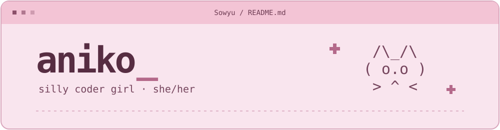

  

  I make native apps, tiny utilities, and things I want to use.
   
  Mostly macOS and Android. Sometimes keyboards.

  
  
  
  

### On my workbench

| Project | What it does |
| :--- | :--- |
| [CandyWrapper](https://github.com/Sowyu/CandyWrapper) | A native version of T3 Code. |
| [CandyWrapper for Android](https://github.com/Sowyu/CandyWrapper-Android) | CandyWrapper on Android. |
| [VectorScroll](https://github.com/Sowyu/VectorScroll) | Vector scrolling for macOS, similar to Firefox or Windows. |
| [InstantSpace](https://github.com/Sowyu/InstantSpace) | A lightweight menu bar app for switching macOS Spaces. |

A few more things

- [aLauncher](https://github.com/Sowyu/aLauncher), my personal mLauncher fork.
- [fumo-Nkeyboard](https://github.com/Sowyu/fumo-Nkeyboard), keyboard tinkering in C++.
- [m5-azahi](https://github.com/Sowyu/m5-azahi), my M5 Pro Linux project.

 

  

